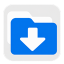
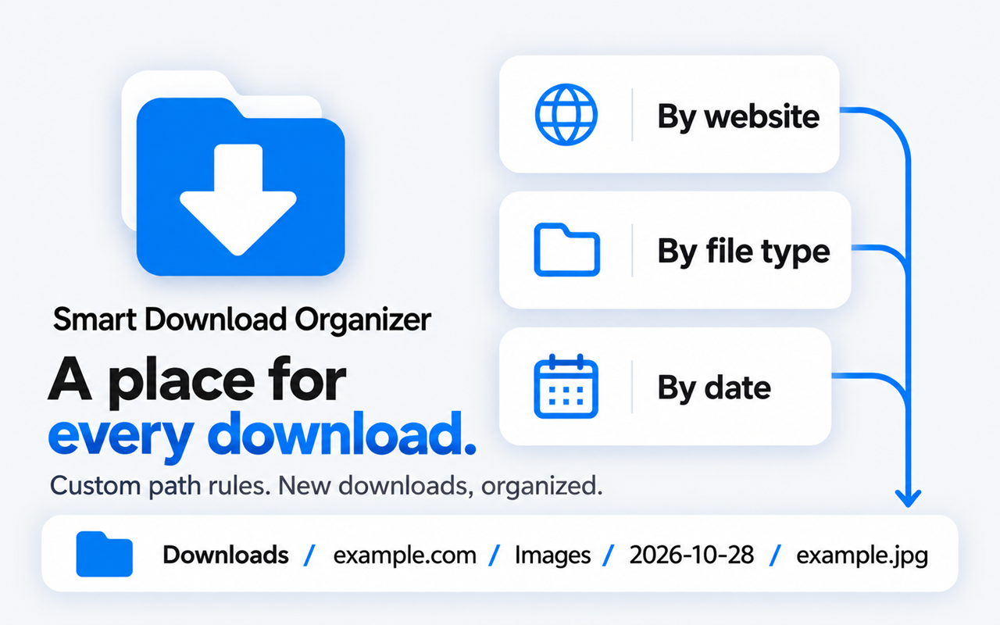
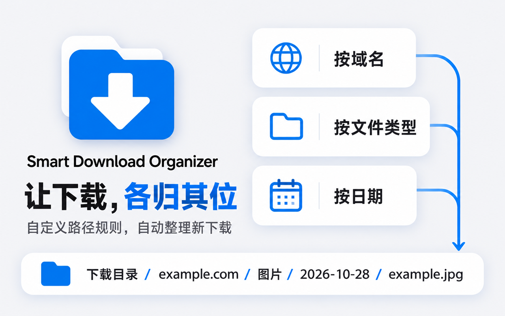

<p align="center">
  
</p>

<h1 align="center">Smart Download Organizer</h1>

<p align="center">A place for every new download · 让新下载各归其位</p>
<p align="center">Free and open source · Chrome / Microsoft Edge · English / 简体中文</p>
<p align="center">
  <a href="#english">English</a> ·
  <a href="#简体中文">简体中文</a> ·
  <a href="https://chromewebstore.google.com/detail/下载路径规则配置-smart-download-o/dihefcbongaiapidifokoklienncabko">Chrome Web Store</a> ·
  <a href="https://microsoftedge.microsoft.com/addons/detail/cpdapmdfjccinmcncpogpbolcboadgdh">Edge Add-ons</a> ·
  <a href="https://github.com/liuyanlong99/Smart-Download-Organizer/releases/latest">Releases</a> ·
  <a href="LICENSE">MIT License</a>
</p>

## English

Smart Download Organizer creates folders for new browser downloads using the source domain, file type and date rules you choose. All processing and settings stay in your browser.

### Install

- **From a store:** [Chrome Web Store](https://chromewebstore.google.com/detail/下载路径规则配置-smart-download-o/dihefcbongaiapidifokoklienncabko) or [Microsoft Edge Add-ons](https://microsoftedge.microsoft.com/addons/detail/cpdapmdfjccinmcncpogpbolcboadgdh).
- **Load version 1.1.0 yourself:** download [smart-download-organizer-1.1.0.zip](https://github.com/liuyanlong99/Smart-Download-Organizer/releases/download/v1.1.0/smart-download-organizer-1.1.0.zip) from the [Release](https://github.com/liuyanlong99/Smart-Download-Organizer/releases/tag/v1.1.0).

To load the ZIP in Chrome or Edge:

1. Extract it to a folder you will keep on your computer.
2. Open `chrome://extensions` or `edge://extensions`.
3. Enable **Developer mode**, then click **Load unpacked**.
4. Select the extracted folder containing `manifest.json`.
5. Pin the extension and open its settings from the popup.

The ZIP includes the extension's runtime files, bundled icons, licenses and installation instructions. No private keys, signing files or personal settings are included. It requires no build step or developer account.

### Features

- **Domain rules:** use an exact domain or a wildcard such as `*.example.com`, and give it a custom folder name. An empty folder name uses the full matching domain.
- **File type folders:** organize images, documents, archives, videos, audio, code, executables and fonts. Add your own categories and extensions, including compound extensions such as `.tar.gz`.
- **Date folders:** select a format such as `YYYY-MM-DD` or `YYYY/MM/DD`, with independent controls for file types and domains.
- **Quick control:** pause or resume organization from the extension popup.
- **Path previews:** check the global settings or an individual rule before saving it.
- **Backup and restore:** export settings to JSON and import them in another installation.
- **English and Simplified Chinese:** switch the interface and built-in folder names.



*Feature illustration; the saved rules determine the actual path.*

### Use and rule behavior

Open the extension's settings, enable the folders you need, and click **Save**. The organization switch takes effect immediately. Changes apply to new downloads; files already on disk stay where they are.

For example, a domain rule for `example.com` with the folder name `Project Assets`, file type folders enabled and date folders enabled can save an image to:

```text
Downloads/Project Assets/Images/2026-10-29/photo.jpg
```

- The first enabled domain rule that matches the download is used. Newly added rules appear at the top.
- Domain settings take priority over global settings. A matching domain-specific file category takes priority over a global category.
- An explicit date setting on a domain rule takes priority over a file category; otherwise the category or global setting applies.
- The main preview shows the global controls. Rule previews show their individual overrides.
- On a fresh installation, domain folders and category-specific date folders start off. Updating existing settings preserves the previous date behavior.
- Paths are relative to the browser's download directory. The extension cannot select an arbitrary absolute path. A browser **Save as** dialog or another download extension can affect the final location.

### Updating and transferring settings

For an unpacked installation, back up settings, extract the new ZIP into the same extension folder, then click **Reload** on the browser's extensions page. Keep the same folder path when updating.

Older supported settings are validated and migrated automatically, with the original configuration backed up in local extension storage before migration. Invalid or newer, unsupported settings are preserved; the settings page offers export and import controls for recovery.

Store and unpacked installations can have different extension IDs and separate storage. To transfer settings, export JSON from the old installation and import it into the new one. Leave one copy enabled when downloading.

### Privacy and permissions

The extension requests only:

| Permission | Purpose |
| --- | --- |
| `downloads` | Suggest a relative filename when a new download starts. |
| `storage` | Save rules, language, switch state and a local migration backup. |

It does not request page access, read page contents, run analytics or upload download information. Settings and migration backups remain in `chrome.storage.local`. Exported JSON files are saved only when you request them.

### Development and support

Node.js is used for syntax and resource validation. There are no npm dependencies.

```sh
npm run check
```

Create the installable ZIP and its SHA-256 checksum in `dist/` with PowerShell:

```powershell
powershell -NoProfile -ExecutionPolicy Bypass -File scripts/package-extension.ps1
```

Report a bug or suggest an improvement in [Issues](https://github.com/liuyanlong99/Smart-Download-Organizer/issues). Include the browser version, extension version and steps to reproduce it. Contributions and sharing the extension are welcome.

The project is released under the [MIT License](LICENSE). Bundled Material Symbols use the [Apache License 2.0](icons/material/LICENSE).

## 简体中文

Smart Download Organizer 在文件开始下载时，根据来源域名、文件类型和日期规则生成保存目录。所有处理和配置都保存在浏览器本地。

### 安装

- **商店安装：**[Chrome Web Store](https://chromewebstore.google.com/detail/下载路径规则配置-smart-download-o/dihefcbongaiapidifokoklienncabko) 或 [Microsoft Edge Add-ons](https://microsoftedge.microsoft.com/addons/detail/cpdapmdfjccinmcncpogpbolcboadgdh)。
- **自行加载 1.1.0：**在 [Release](https://github.com/liuyanlong99/Smart-Download-Organizer/releases/tag/v1.1.0) 下载 [smart-download-organizer-1.1.0.zip](https://github.com/liuyanlong99/Smart-Download-Organizer/releases/download/v1.1.0/smart-download-organizer-1.1.0.zip)。

在 Chrome 或 Edge 中加载 ZIP：

1. 将 ZIP 解压到准备长期保留的文件夹。
2. 打开 `chrome://extensions` 或 `edge://extensions`。
3. 开启**开发者模式**，点击**加载已解压的扩展程序**。
4. 选择包含 `manifest.json` 的解压目录。
5. 固定扩展图标，从弹出窗口打开设置。

ZIP 包含运行文件、本地图标、许可证和安装说明，不含私钥、签名文件或个人配置，无需编译或注册开发者账号。

### 功能

- **域名路径规则：**支持精确域名和 `*.example.com` 通配符，可设置专属路径名称；留空时使用匹配到的完整域名。
- **文件类型目录：**内置图片、文档、压缩包、视频、音频、代码、可执行文件和字体分类，也可以添加自定义分类及后缀，支持 `.tar.gz` 等复合后缀。
- **日期目录：**支持 `YYYY-MM-DD`、`YYYY/MM/DD` 等格式，可按文件类型和域名单独设置。
- **快捷开关：**在扩展小窗口中暂停或恢复自动整理。
- **路径预览：**保存前查看全局配置或具体规则的路径效果。
- **备份与恢复：**通过 JSON 文件备份配置，或迁移到其他安装。
- **中英文切换：**切换界面语言和系统分类的目录名称。



*上图为功能示意，实际保存路径由已保存的规则决定。*

### 使用和规则

打开扩展设置，开启所需的目录选项后点击**保存**。自动整理总开关立即生效。规则用于新的下载，已有文件保持原位置。

例如，为 `example.com` 设置路径名称 `项目素材`，开启文件类型和日期目录，图片可以保存到：

```text
下载目录/项目素材/图片/2026-10-29/photo.jpg
```

- 使用列表中第一条匹配且启用的域名规则，新添加的规则位于顶部。
- 域名配置优先于全局配置；匹配的域名专属文件分类优先于全局分类。
- 域名明确设置的日期规则优先于文件分类，否则使用分类或全局的日期配置。
- 首页预览反映全局开关，规则中的预览反映该规则的单独配置。
- 全新安装时，按域名创建目录和分类内的日期目录默认关闭；升级已有配置时保留原来的日期行为。
- 路径基于浏览器的下载目录，不能指定任意绝对路径。浏览器“另存为”对话框或其他下载扩展可能影响最终位置。

### 更新和配置迁移

已解压安装的版本更新时，先备份配置，将新 ZIP 解压覆盖到同一个扩展目录，再在扩展管理页点击**重新加载**。更新时保留原文件夹路径。

兼容的旧配置会经过校验并自动迁移，迁移前会在扩展本地存储中备份原始配置。遇到无效配置或不支持的更高版本配置时会保留原数据，设置页面提供导出和导入入口，便于修复。

商店安装与自行加载的扩展可能具有不同 ID，配置存储也相互独立。迁移时，在旧扩展中导出 JSON，再到新扩展中导入；下载时保留一个扩展副本处于启用状态。

### 隐私和权限

扩展仅申请以下权限：

| 权限 | 用途 |
| --- | --- |
| `downloads` | 在下载开始时建议相对保存路径。 |
| `storage` | 保存规则、语言、开关状态及本地迁移备份。 |

扩展不申请网页访问权限，不读取网页内容，不使用统计服务，也不上传下载信息。配置和迁移备份保存在 `chrome.storage.local`，只有手动导出时才会生成 JSON 文件。

### 开发和反馈

使用 Node.js 运行语法和资源校验，无需安装 npm 依赖：

```sh
npm run check
```

使用 PowerShell 生成可加载的 ZIP 和 SHA-256 校验文件，输出至 `dist/`：

```powershell
powershell -NoProfile -ExecutionPolicy Bypass -File scripts/package-extension.ps1
```

遇到问题或有改进建议，请在 [Issues](https://github.com/liuyanlong99/Smart-Download-Organizer/issues) 中提供浏览器版本、扩展版本和复现步骤。欢迎参与改进或分享扩展。

项目采用 [MIT 许可证](LICENSE)，内置 Material Symbols 图标采用 [Apache License 2.0](icons/material/LICENSE)。
